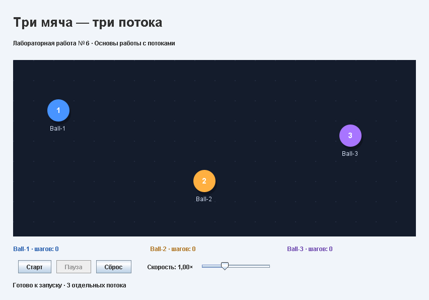

# Лабораторная работа № 6

Три мяча отскакивают от границ поля. Каждый мяч реализует `Runnable` и работает в собственном `Thread`: `Ball-1`, `Ball-2`, `Ball-3`. Под полем отображается число шагов каждого потока.

«Старт» запускает движение, «Пауза» приостанавливает его, «Продолжить» возобновляет. «Сброс» возвращает исходные позиции и обнуляет счётчики. Ползунок регулирует скорость. Размер окна можно менять.

## Работа с потоками

Координаты обновляются в трёх рабочих потоках с интервалом 16 мс. Общие данные защищены `synchronized`. На паузе потоки ожидают через `wait()`, продолжение использует `notifyAll()`. При закрытии окна выполняются `interrupt()` и `join()`.

Swing-компоненты создаются и обновляются в EDT. Таймер интерфейса обновляет подписи и запрашивает перерисовку. Движение вычисляют рабочие потоки, отрисовка читает согласованные снимки координат.

## Структура проекта

- `src/Main.java` — точка входа: создаёт окно приложения и завершает рабочие потоки при его закрытии.
- `src/AnimationPanel.java` — интерфейс: рисует мячи, отображает счётчики шагов, обрабатывает кнопки и изменение скорости.
- `src/Ball.java` — мяч и его отдельный поток: обновляет координаты, рассчитывает отскоки, управляет паузой, продолжением, сбросом и завершением.
- `demo.gif` — демонстрация работы приложения: движение, пауза, продолжение, изменение скорости и сброс.
- `.gitignore` — исключает из Git результаты сборки и настройки среды разработки.
- `README.md` — описание приложения, работы потоков и структуры проекта.
